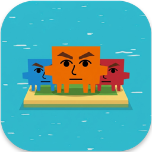

<div align="center">



# Mii-nagement

<a href="https://www.youtube.com/watch?v=bhfhtuuFQPg"></a>

**A Tomodachi Life inspired agent management system where your coding agents live, interact with each other, and ship real code.**


</div>

---

## What is Mii-nagement?

Mii-nagement is a Tomodachi Life-style manager for teams of coding agents doing real
software work. Each project is an **island** (a git repository on your machine), each
agent is a **resident** with a job, a personality and a real coding agent for a brain, and
the town's buildings and roads are your workflow. Hand the island a task and watch your
residents carry it from building to building until it comes out as a pull request.

## Features

- **Islands are projects.** Create a fresh repo, clone one from GitHub, or point at a
  folder you already have. Residents work in their own git worktrees, so your checkout
  is never touched.
- **Residents with brains.** Give each resident a name, a job, personality sliders and a
  brain: Claude Code, Codex or Gemini CLI (over the open
  [Agent Client Protocol](https://agentclientprotocol.com)), or any
  [OpenRouter](https://openrouter.ai/models) model.
- **Your town is your workflow.** Mailbox plans, Workshop codes, Lab tests, Courthouse
  reviews and Post Office opens the pull request. Drag buildings and roads to change the
  flow; failures go back down the `fail` road.
- **Bubbles when they need you.** Questions, ✋ permission for shell commands and
  "approve & merge" pop up over a resident's head.
- **Several packages at once**, with GitHub issues as tasks, plus island News and Insights.
- **Safe by default.** Agents only read and write inside the island's own worktrees, and
  shell commands ask first. API keys live in your OS keychain, never the database.

## How it works

```
┌───────────────────────────┐   WebSocket (JSON events)   ┌──────────────────────┐
│ backend/  (Python)        │ ──────────────────────────▶ │ game/  (Godot 4)     │
│ Django · workflow engine  │     ws://localhost:8000/ws  │ draws the island,    │
│ ACP agents · SQLite       │ ◀────────────────────────── │ sends your clicks    │
│ git worktrees             │   commands + HTTP requests  │ (no agent logic)     │
└───────────────────────────┘                             └──────────────────────┘
```

The backend decides everything (workflow, agents, permissions, moods); the game only
shows events and sends your input.

| Folder | What's in it |
|---|---|
| `backend/` | Django + Channels server: workflow engine, agent runners, events, insights |
| `game/` | Godot 4 client: the 3D island, UI, residents, bubbles |
| `docs/` | [architecture](docs/architecture.md) (start here), [WebSocket protocol](docs/protocol.md), [HTTP API](docs/http-api.md) |
| `deploy/` | The website and downloads ([deploy/README.md](deploy/README.md)) |

## Set it up locally

You need [uv](https://docs.astral.sh/uv) (`brew install uv`, or see its docs) and
[Godot 4.7](https://godotengine.org/download).

```bash
git clone https://github.com/jkusuda/Mii-nagement.git
cd Mii-nagement
make
```

`make` installs the backend's dependencies, starts the backend and opens the game. Ctrl+C
or closing the game stops both. If Godot isn't on your PATH or in `/Applications`, run
`make GODOT=/path/to/godot`.

Then install at least one brain (each is optional, and Settings in the game shows which
ones it can see):

| Brain | Needs |
|---|---|
| `claude-code` | [Node.js](https://nodejs.org) and the `claude` CLI, logged in once |
| `codex` | Node.js and `codex login` |
| `gemini` | the Gemini CLI, logged in once |
| `openrouter` | nothing to install, just an OpenRouter key in Settings |

For GitHub (clone, issues as tasks, PRs) install the [GitHub CLI](https://cli.github.com)
and run `gh auth login`.

**Just want the app?** Download the Mac or Windows build from the website. The Mac app
isn't notarized (System Settings > Privacy & Security > Open Anyway) and the Windows
installer isn't code-signed (SmartScreen > More info > Run anyway).

### Contributing

Read [docs/architecture.md](docs/architecture.md) and [CLAUDE.md](CLAUDE.md) first, then:

```bash
make check   # lint + backend tests + Godot script check (CI runs the same)
make fmt     # format both halves
make help    # everything else
```
